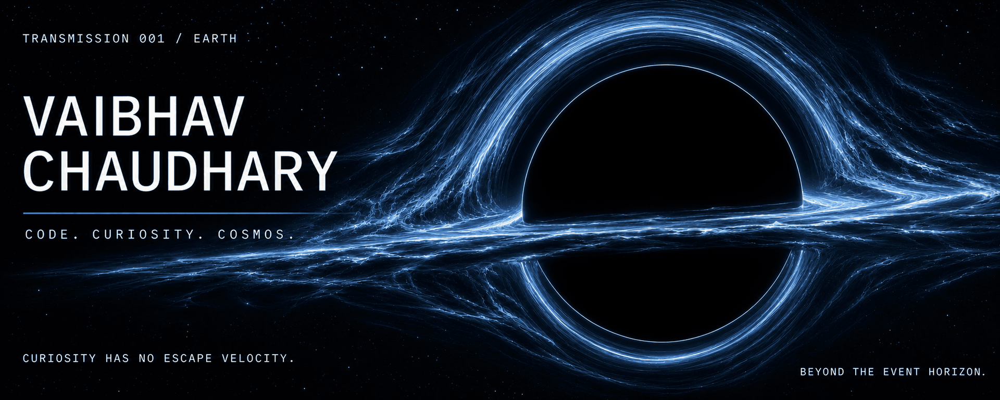

  <picture>
    <source media="(prefers-reduced-motion: reduce)" srcset="./gargantua-banner.png" />
    
  </picture>

**Building things that make people say, “wait, you made that?”**

CS + AI student · Curious builder

<a href="https://vaibhavchaudhary.vercel.app">Portfolio</a> &nbsp; / &nbsp;
<a href="https://www.linkedin.com/in/vaibhav-chaudhary-9380b142b/">LinkedIn</a> &nbsp; / &nbsp;
<a href="mailto:vaibhavchaudhary767@gmail.com">Send a transmission</a>

 

*My code and Nolan films have one thing in common: sometimes I need a second watch to understand what happened.*

